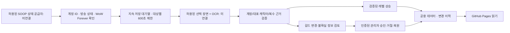

# SOOP 방송 자동 분석 — 구현 범위와 운영 설계

현재 버전은 **검증·대기열·승인·복원 시스템을 구현한 단계**입니다. 실제 방송 감지, 영상 수집, OCR/영상 모델, 운영 서버 배포를 완료한 시스템이 아닙니다. 작업 브랜치 `feat/soop-analysis-review-system`은 미배포이며 기존 엑셀/사진 기능 브랜치에 의존합니다.

## 단계별 현재 결과

| 단계 | 상태 | 실제 확인 내용 |
|---|---|---|
| 1. SOOP 방송 상태 조회 | 검증 대기 | 제공받은 `validate/live/status`는 사용자 토큰만 받는 Consent API. 임의 150명 조회 권한은 미확인. `broad/list`도 인증/한도 미확인. 실제 상태 공급자 미구현. |
| 2. 허용된 영상 분석 경로 | 접근 검증 대기 | 사용자는 ecvhao 방송과 VOD `190574265`의 캡처·자동 분석·추출 정보 공개 허락을 확인했습니다. 이 허락을 다른 계정에 확대하지 않았습니다. 영상 페이지는 환경 CONNECT 403으로 열리지 않았고 플랫폼 측 접근 방식은 미확인입니다. |
| 3. 3~5개 실제 방송 시험 | 미실시 | 실제 분석 0개. 캐릭터·레벨·길드 정확도, 실행 시간, 비용은 모두 미측정입니다. 모의 테스트를 실제 영상 검증으로 취급하지 않습니다. |
| 4. 변경 검증·이력·승인·복원 | 모의 입력으로 구현/검증 | Python 정책 엔진, SQLite 트랜잭션 저장소, 분리된 worker 루프, 관리자 검수 화면, 공용 데이터의 조건부 로딩. |
| 5. 150명 이상 확대 | 대기열 모의 검증만 완료 | 180명 모의 상태로 동시 실행 한도·중복 할당 방지·재시작 후 쿨다운을 확인했습니다. 실제 150명 수집 부하 시험은 아닙니다. |

**다시보기는 정확도 평가 전용**이며 현재 라이브 레코드를 자동 갱신하는 입력으로 사용하지 않습니다. 엔진은 `authorized-live-sample` 소스만 자동 반영 후보로 취급하고 VOD/미확인 소스는 보존 처리합니다.

실제 시험 관측치는 `automation/pilot-report.json`에 있으며 성공률이나 비용을 만들어 넣지 않았습니다. 사용자 권한 확인은 `automation/config.json`의 ecvhao 승인 기록에 보존합니다. 영상 다운로드·캡처·HLS 추출·플레이어 인증 우회 코드는 추가하지 않았습니다.

## 작업 분리와 10분 정책



- 상태 확인과 영상 분석은 `automation/service.py`의 독립 루프입니다. 상태 확인 주기 초안은 60초이며 실제 API 호출 한도를 확인한 뒤 공급자에서 제한해야 합니다. 기본값에서는 공급자와 권한이 없어 요청하지 않습니다.
- **대상별 분석 시작 간격은 최소 600초**이며 10분 내 두 번 시작하지 않습니다. 시작 시각·다음 가능 시각을 SQLite에 먼저 기록합니다. 분석 실패·취소·worker 종료에도 즉시 재시도하지 않습니다.
- 상태가 신선하고(초안 120초), 실제 방송 중이며, WoW와 Forever 서버가 검증되고, 계정별 영상 분석 허락과 활성화가 모두 있는 대상만 분석합니다. 제목에 ‘와우’가 있다는 이유만으로 Forever로 분류하지 않습니다. 서버 식별 공급자는 아직 미구현입니다.
- 기본 동시 실행은 2개, 계정당 진행 작업은 1개입니다. 더 많은 대상은 가장 오래 대기한 순서로 처리합니다. 분석 완료 뒤 다음 대상을 할당하며, 이미 분석한 대상은 600초가 지나야 다시 들어옵니다.
- 과부하 때는 다음 실행이 늦어질 수 있습니다. ‘10분마다 최대 1회’는 보장하는 제한이며, 모든 대상을 10분 정각에 완료한다는 보장은 아닙니다. 만료 lease는 실패로 남고 기존 데이터는 보존됩니다.
- 한 작업의 근거는 최대 3개 선택 장면입니다. 연속 영상 전체를 모델에 전송하지 않습니다. 실제 장면 선택·추출기는 구현되지 않았습니다.

## 자동 반영 규칙

`automation/engine.py`는 정규화된 공급자 결과에 다음을 검사합니다.

- SOOP 계정·방송 번호·현재 대표 캐릭터 ID가 작업 시작 때와 일치해야 합니다. 작업 중 대표 캐릭터·레벨·길드가 수동 변경되면 적용하지 않습니다.
- 서로 다른 근거 화면 최소 2개, 5초 이상 시차, 작업 시간 내 확인된 타임스탬프가 필요합니다. 이름이 정확히 일치하고 본인 정보창/본인 길드창/본인 레벨업으로 소유 여부가 확인되어야 합니다. 타인 선택창은 사용할 수 없습니다.
- 신뢰도 초안은 각 근거 0.99 이상입니다. **모델이 말하는 0.99를 실제 정답 확률로 간주하지 않습니다.** 실제 시험으로 OCR/소유자 판별·신뢰도를 보정하고 `realPilotPassed`를 승인하기 전에는 자동 적용이 차단됩니다.
- 현재 레벨이 숫자로 등록되어 있고 동일 레벨 상승이 근거들에서 일치하면 1레벨 상승까지 자동 적용합니다. 2레벨 이상 상승은 우선 검토에 남깁니다. 현재 레벨 미확인 상태를 임의로 채우지 않습니다.
- 레벨 하락·다른 캐릭터·낮은 신뢰도·불일치 근거는 자동 적용하지 않습니다.
- **길드 변경은 초기 버전에서 항상 관리자 승인**입니다. 이미 등록된 길드 ID로만 적용하며, OCR로 처음 본 길드를 자동 생성하지 않습니다. 기존 길드 이력을 유지하고 변경/복원 때 추가 기록합니다.
- 같은 이전 값→새 값의 변경은 중복 적용하지 않습니다. 반려·복원한 변경을 같은 증거로 자동 재적용하지 않습니다.
- 확인 시각, 이전/새 값, 처리 사유·결과, 작업 ID, 근거 메타데이터/해시, 신뢰도, 처리 주체와 시각을 기록합니다. 복원은 현재 값이 원래 적용한 새 값과 같을 때만 허용해 나중 변경을 덮어쓰지 않습니다.
- 방송 종료·상태 만료·분석 실패·권한 해제 때는 데이터가 바뀌지 않습니다. 종료/실패를 임의 레벨·길드로 해석하지 않습니다.

정책 엔진의 `selfConfirmed` 같은 입력은 검증된 공급자가 만들어야 합니다. 현재는 실제 모델이나 소유자 검증기가 없어 이 값을 자동 생산하지 않습니다. 사용자 임의 JSON을 신뢰할 수 있는 실제 영상 증거로 인정하는 운영 시스템으로 배포하면 안 됩니다.

## 서버 및 GitHub Pages 연결

권장 구조는 **단일 상시 worker + 영구 볼륨 SQLite + 비밀 관리 + 인증된 관리자/API + 정적 공개 스냅샷**입니다. 여러 서버로 확대한다면 PostgreSQL 등 공유 트랜잭션 저장소로 교체해야 합니다. SQLite 파일을 여러 서버의 네트워크 디스크에 공유하는 설계는 아닙니다.

- `automation/store.py`: SQLite `BEGIN IMMEDIATE`로 작업 예약·데이터 갱신·변경 기록을 원자적으로 저장합니다. worker 두 개가 같은 DB를 사용해도 같은 계정을 중복 할당하지 않습니다.
- `automation/service.py`: 상태 공급자와 영상/OCR 공급자를 주입하는 실행 골격입니다. 기본 공급자는 없고, 미연결 상태에서 `run_forever()`는 실행을 거부합니다. 브라우저 없이 실행할 수 있지만 실제 서버에 배포한 것은 아닙니다.
- `.github/workflows/analysis-review.yml`: 10분 cron을 정의한 **오프라인 검수 재생용**입니다. 스케줄 job은 변수 `WAPO_ANALYSIS_REPLAY_ENABLED=true` 전까지 건너뜁니다. 실제 영상 수집기나 자동 공개 workflow가 아닙니다. Actions 스케줄 자체도 지연될 수 있어 엄격한 실시간 timer로 쓰지 않습니다.
- `automation/runner.py`: 정규화된 상태/관측/승인 파일을 재생하고 검수 산출물을 만듭니다. 기본은 산출물만 생성합니다. `--publish`도 migration·실제 시험·접근 권한·publication 플래그가 모두 확인되지 않으면 거부합니다. 실제 원격 GitHub push/Pages 배포 작업은 아직 연결하지 않았습니다.
- `public-archive.js`: 공용 데이터 manifest가 활성일 때만 같은 사이트의 공개 스냅샷을 읽습니다. 현재 manifest는 **비활성**입니다. 새 공용 값을 메모리에 병합하되 로컬 백업 키를 지우거나 쓰지 않고, 기존 사진·추가 로컬 기록·즐겨찾기·BGM을 유지합니다. 원격 장애 시 기존 데이터를 유지합니다.
- 자동으로 전체 방문자에게 반영하려면 승인된 worker 결과를 GitHub App/최소 권한 토큰으로 공개 스냅샷 한 파일에 반영하고 Pages 배포를 확인하는 publishing 어댑터가 추가로 필요합니다. 브라우저에 GitHub/SOOP/모델 토큰을 넣지 않습니다. 이 어댑터와 클라우드 자격 증명은 현재 미설정입니다.

### 기존 데이터 이전

현재 사이트의 데이터는 운영자 브라우저의 localStorage에 있을 수 있습니다. 실제 백업 파일을 받기 전에는 공용 원본이 준비됐다고 가정하지 않습니다.

1. 기존 관리자에서 JSON 백업을 다운로드하고 개인 보관합니다.
2. `python automation/migrate_backup.py /안전한경로/백업.json --output /안전한경로/public-archive.json`으로 공개용 투영을 만듭니다. 기존 파일 덮어쓰기는 거부합니다.
3. 원래 ID·대표 캐릭터·길드·사진·20인 슬롯 등을 검수합니다. 제보·알 수 없는 비공개 필드는 공개용에서 제외하지만 원본 백업은 변경하지 않습니다.
4. 승인된 공용 원본을 서버 DB에 초기화하고 백업/복구를 검증합니다. `Store.initialize()`도 기존 DB 덮어쓰기를 거부합니다.
5. 실제 시험 통과 후 공개 스냅샷과 manifest를 함께 검수해 배포합니다. 현재 자동 전환하지 않습니다.

공개 스냅샷에는 제보·토큰·원본 프레임·미승인 관측 내용을 넣지 않습니다. public projection은 허용한 필드만 내보냅니다. 공개 GitHub 저장소의 Actions 산출물도 비공개 저장소라고 가정하지 않아, 기본 workflow에서는 보류 증거가 제거된 보고서만 업로드합니다. 원본 영상/프레임과 불확실한 검수 자료는 접근을 제한한 별도 서버/비공개 저장소에 보관해야 합니다.

## 관리자 화면

기존 관리자 메뉴에 ‘방송 자동 분석’ 탭을 추가했습니다.

- 대상별 활성 상태, 최근/다음 분석 시각, 상태·대기·오류, 보고된 비용, 변경·근거 조회.
- 승인·거절·복원·대상별 활성화 요청을 JSON으로 다운로드.
- **버튼 클릭만으로 서버 데이터가 바뀌었다고 표시하지 않습니다.** 현재 홈페이지에는 서버 관리자 인증이 없으며 GitHub 환경의 Required reviewers 규칙도 아직 설정하지 않았으므로, GitHub 로그인/보호된 환경에서 검수한 요청을 재생해야 합니다. 실운영용 인증 API는 미구현입니다.
- 실제 보고서가 없으면 ‘아직 없음/미측정/실행하지 않음’으로 표시합니다. 가짜 대상·예시 수치·성공 기록은 사이트에 등록하지 않습니다.

## 비용과 확장

동시 방송자 수를 `N`, 한 번 분석의 실제 단가를 `C`라고 하면 분석비의 시간당 추정치는 **N × 6 × C**입니다. 상태 조회·서버·저장·네트워크 비용은 별도입니다. C를 아직 측정하지 않았으므로 원화/달러 금액을 임의 산정하지 않습니다.

- 10분 안에 모두 처리하려면 `동시 실행 수 × 600 / 평균 분석 시간(초) ≥ N`을 만족해야 합니다. 실제 실행 시간 측정 전에는 동시 실행 2개로 150명 모두를 정확히 10분마다 처리할 수 있다고 주장하지 않습니다.
- 예상 단가·일일 예산이 미설정이면 새 분석을 예약하지 않습니다. 실행 중 예약 비용도 예산에 포함합니다. 사용량 미보고/worker lease 만료는 예약 단가를 보수적으로 비용에 반영합니다.
- 실제 단가는 모델의 텍스트 추정값이 아니라 provider 사용량/청구 메타데이터로 기록해야 합니다. 예상치를 넘는 비용 가능성은 외부 provider의 토큰·화면수·계정별 한도에서도 제한해야 합니다.
- 검수 요청/취소/중복 완료는 다시 비용을 청구했다고 기록하지 않습니다. 기록 보존·집계·삭제 정책은 운영 서버 준비 시 추가해야 합니다. 현재 JSON 이력은 프로토타입이며 장기간 무한 누적 운영용 분할 저장은 미구현입니다.

## 실제 시험 계획

현재 허락 범위는 ecvhao와 제공된 VOD입니다. 우선 이 영상의 허용된 파일/클립 또는 정상 접근 경로를 확보해야 합니다. 그다음 3~5개 **서로 다른 실제 방송 세션**에서 허락 범위에 맞게 표본을 확보합니다. 한 영상의 장면 5개를 방송 5개로 세지 않습니다.

사람이 정답을 라벨링한 캐릭터창·길드창·레벨업, 타인 선택창, 부캐, 화면 압축, 가려짐, 다른 방송 재생 장면 등을 포함해 캐릭터 귀속·레벨·길드 정밀도를 따로 측정합니다. 잘못된 자동 반영 건수, 검토로 보내야 할 표본 누락, 처리 시간, 건당 실제 비용을 기록합니다. 잘못된 자동 반영이 발견되면 자동 레벨 반영을 켜지 않고 원인·임계값을 조정합니다. OCR/모델 선정과 정량 합격 기준 승인도 아직 남아 있습니다.

## 검증한 범위

```sh
python -m unittest discover -s tests/automation -v
python automation/runner.py --out /tmp/analysis-disabled
python scripts/build.py
python -m http.server 4173
# 다른 터미널 (playwright / Chromium 필요)
python tests/automation/test_browser.py
python scripts/test_book_ui.py
```

모의 테스트: 180명 대기열, 600초 제한, 동시 실행/재시작 중복 방지, 계정별 허락, WoW/Forever 확인, 높은/낮은 신뢰도, 레벨 상승/하락, 대표 캐릭터/방송 변경, 길드 승인/이력/복원, 나중 변경 보호, 실패/비용/예산, public 개인정보 제외, 브라우저 관리자·공용 로딩·기존 기능 보존. 실제 영상 분석 정확도를 검증한 테스트는 아닙니다.
